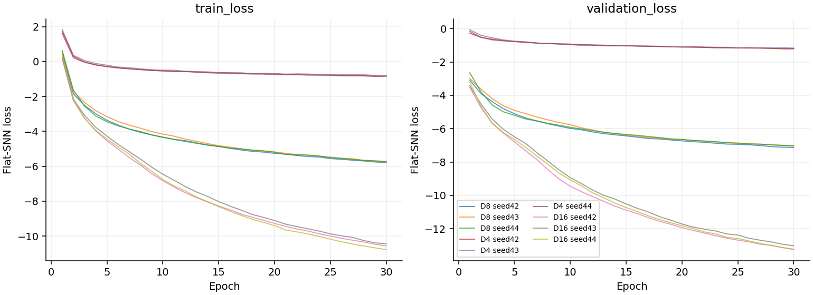

# 已训练的轨迹 Encoder

已完成 [PLAN.md](PLAN.md) 中的 Encoder 实验：**12 组独立训练，每组 30 轮，共 360 轮**。最终冻结模型为 **16 维、sum pooling、seed 43**，RDP ε=120m、τ=0.01；验证集选择的 checkpoint 为第 30 轮。模型已完成 CPU 加载、参数冻结和真实轨迹推理校验。

**[下载训练完成的 encoder.pt](encoder/encoder.pt?raw=1)** · **[中文结果报告](reports/RESULTS_ZH.md)** · **[全部 9 份对照权重](checkpoints/)**

所选模型在四个代理上均未超过两种基线中的较强者，因此这些测试尚未证明自监督训练带来了额外的几何代理预测能力。 几何代理结果不等于人工复杂度真值。

| 文件 | 用途 |
|---|---|
| [encoder/encoder.pt](encoder/encoder.pt) | 选定的可加载权重，内含模型配置与训练集预处理参数 |
| [encoder/config.json](encoder/config.json) | 最终模型、checkpoint 轮数及验证选择记录 |
| [encoder/embeddings.npz](encoder/embeddings.npz) | 全部 16183 条轨迹的 sum / mean / signed GeM-p2 向量 |
| [encoder/example_input_output.npz](encoder/example_input_output.npz) | 一条真实 TEST 轨迹及对应 token / 轨迹向量 |
| [reports/checkpoint_manifest.json](reports/checkpoint_manifest.json) | 9 份权重的 SHA256、字节数、种子与选定轮数 |
| [reports/probe_summary.csv](reports/probe_summary.csv) | 三维数 × 三种子 × 三种 pooling 的测试指标 |
| [reports/three_seed_summary.json](reports/three_seed_summary.json) | 三种子均值与样本标准差 |
| [experiment_logs/](experiment_logs/) | 每组实验的逐轮损失、参数及验证结果 |

## 直接加载

Python 3.10。先将仓库下载到本地，在独立环境安装 CPU 推理依赖：

```powershell
python -m venv .venv
.\.venv\Scripts\python.exe -m pip install torch==2.7.1 --index-url https://download.pytorch.org/whl/cpu
.\.venv\Scripts\python.exe -m pip install -r requirements.txt
.\.venv\Scripts\python.exe example.py
.\.venv\Scripts\python.exe verify_delivery.py
```

加载自己的 1Hz 坐标：

```python
from trajectory_encoder.inference import FrozenEncoder

encoder = FrozenEncoder("encoder/encoder.pt", pooling="sum", device="cpu")
result = encoder.encode(enu_m, resample_from_1hz=True)
print(result["tokens"].shape)     # 采样点数 × 16
print(result["embedding"].shape)  # (16,)
```

输入为 RKSI 本地 ENU 米制坐标的 N×3 数组。接口按每 5 秒一点并保留终点采样，采样后至少 30 点；已经按该规则采样的输入使用 `resample_from_1hz=False`。预处理统计量随权重保存，推理时不重新拟合。模型关闭 dropout 并冻结参数；sum 向量不额外做 L2。

## 实验与结果

数据为公开 [ATFMTraj](https://huggingface.co/datasets/petchthwr/ATFMTraj) 的 RKSIa。训练 / 验证 / 测试为 6877 / 1214 / 8092 条；官方 TRAIN 划出验证集，官方 TEST 保留用于最终评估。六个本地 TSV 的 SHA256 与公开数据版本逐个匹配，记录见 [public_data_verification.json](reports/public_data_verification.json)。原始 TSV 不随仓库分发。

模型使用 9 维输入、4 层 causal Transformer、宽 256、FFN 512、4 头、dropout .35、20% 输入掩码与 RDP flat-SNN。先完成 ε=120/1200m × τ=.01/.05 的四组 8 维筛选，再固定所选参数比较 4/8/16 维各三个种子。真实 batch=16，AdamW lr=1e-5，bf16；本次训练设备为 RTX 5060 Laptop 8GB。sum 为预先固定的主 pooling；mean 与 signed GeM-p2 用于敏感性分析。

所有超参数、维数及代表 seed 均只用验证集选定，随后才运行 TEST。完整规则见 [PROTOCOL.md](PROTOCOL.md)，实现检查见 [implementation_checks.json](reports/implementation_checks.json)，导出校验见 [export_verification.json](reports/export_verification.json)。




## 重新训练

下载 RKSIa 的六个 TSV 与 `RKSIa_stats.csv` 至同一目录。训练需要支持 bf16 的 CUDA 环境；本次使用 PyTorch 2.7.1+cu128。建立独立环境后，将 PyTorch 安装源换成官方 `https://download.pytorch.org/whl/cu128`，再执行：

```powershell
.\.venv\Scripts\python.exe -m trajectory_encoder.data --source "你的RKSIa数据目录" --out prepared
.\.venv\Scripts\python.exe -m trajectory_encoder.checks
.\.venv\Scripts\python.exe -m trajectory_encoder.benchmark
.\.venv\Scripts\python.exe complete_local.py
```

训练缓存写入 `runs/`；交付的历史记录保存在 `experiment_logs/`，不会被误作本地已完成训练。

实现参考固定提交的 [ATSCC](https://github.com/petchthwr/ATSCC/tree/789ccd72b7496b52e03df7d8599d8c9e6659bdb9)，许可见 [THIRD_PARTY_LICENSE_ATSCC.md](THIRD_PARTY_LICENSE_ATSCC.md)，引用见 [CITATION.md](CITATION.md)。这是按当前计划改造的 ATSCC/ITSC-inspired Encoder。当前数据缺绝对时间和真实航班 ID，小时复杂度系统未作验证。
